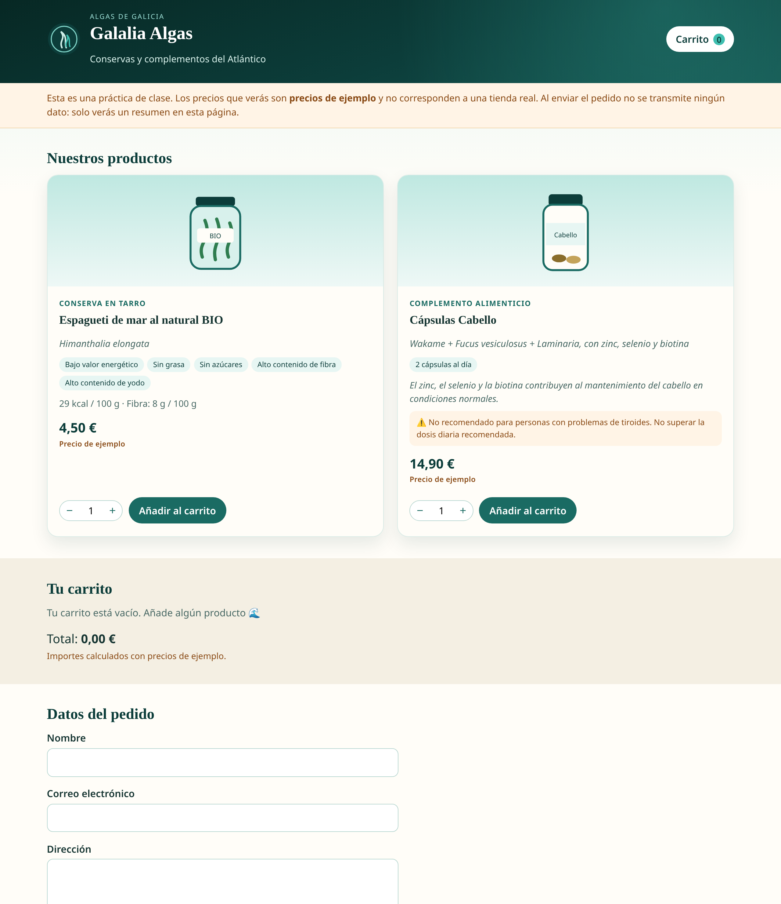

# Galalia Algas — App de pedidos (práctica)

App web de pedidos de ejemplo para **Galalia Algas**, una marca de algas de Galicia. Sirve para practicar un README de proyecto y publicar una página gratis con **GitHub Pages**.

Incluye dos productos del ejercicio del CEMP:

- **Espagueti de mar al natural BIO** (*Himanthalia elongata*), conserva en tarro. Alegaciones: bajo valor energético, sin grasa, sin azúcares, alto contenido de fibra y alto contenido de yodo (29 kcal/100 g y 8 g de fibra/100 g).
- **Cápsulas Cabello**, complemento alimenticio (2 cápsulas al día) con wakame, *Fucus vesiculosus* y *Laminaria*, más zinc, selenio y biotina. «El zinc, el selenio y la biotina contribuyen al mantenimiento del cabello en condiciones normales.» No está recomendado para personas con problemas de tiroides y no debe superarse la dosis diaria.

Los importes que aparecen (**4,50 €** y **14,90 €**) son **precios de ejemplo**. No es una tienda real: el pedido no se envía a ningún servidor; el resumen solo se muestra en el navegador y el carrito se guarda en `localStorage`.

## 🚀 Cómo empezar

1. Clona el repositorio (cambia `TU-USUARIO` por el tuyo):

   `git clone https://github.com/TU-USUARIO/galalia-pedidos.git`

2. Abre el archivo `index.html` en el navegador (doble clic o arrástralo a una pestaña).

No hace falta instalar nada ni ejecutar ningún comando de compilación: es HTML, CSS y JavaScript puros.

## 🛠️ Tecnologías

- HTML
- CSS
- JavaScript (sin librerías ni frameworks)

## 📸 Captura



## 🌐 Publicar en GitHub Pages

1. Crea un repositorio en GitHub (por ejemplo, `galalia-pedidos`) y sube estos archivos:

   ```
   git init
   git add index.html style.css app.js README.md captura.png favicon.svg
   git commit -m "Primera versión de la app de pedidos de Galalia Algas"
   git branch -M main
   git remote add origin https://github.com/TU-USUARIO/galalia-pedidos.git
   git push -u origin main
   ```

2. En GitHub, entra en **Settings → Pages**.
3. En *Source* (origen), elige la rama `main` y la carpeta `/ (root)`.
4. Pulsa **Save**. En uno o dos minutos tendrás una dirección del tipo:

   `https://TU-USUARIO.github.io/galalia-pedidos/`

## 🙋 Ayuda

Si tienes dudas, abre un *issue* en este repositorio o escribe a la autora.

## 👩‍💻 Autora

Eulalia Ceo de Carvalho · Estudiante del Máster Full Stack de Conquer Blocks
Proyecto de pedidos de Galalia Algas - clase de Git
Proyecto de pedidos de Galalia Algas - clase de Git
